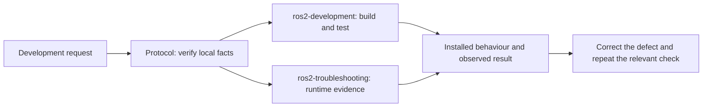

<div align="center">


**Kontextbezogene Bündelung von ROS-2-Verifikationswerkzeugen, Workflows und Übergabenachweisen.**


[English](README.md) | [한국어](README.ko.md) | [中文](README.zh.md) | [日本語](README.ja.md) | [Español](README.es.md) | [Français](README.fr.md) | **Deutsch**

</div>

Drei Skills für **Claude Code und Codex** für **Ubuntu 24.04 / ROS 2 Jazzy**: Pakete entwickeln, Tests und installierte Artefakte prüfen und Laufzeitfehler diagnostizieren.

Dieses Repository bündelt Domänenwissen, Arbeitsabläufe und ausführbare Diagnosewerkzeuge gemäß dem [Agent Skills Standard](https://agentskills.io/home). Anstatt eine Steigerung der inhärenten Codegenerierungsfähigkeiten von Spitzenmodellen zu behaupten, untersucht dieses Projekt eine technische Hypothese: **Die Bündelung umgebungsspezifischer Nachweisprüfungen und strukturierter Übergabeprotokolle (Handoffs) kann Verifikationsunklarheiten und Kontextübertragungskosten zwischen Sitzungen oder Beteiligten reduzieren.** Während die Funktion einzelner Werkzeuge in Testszenarien bestätigt wurde, **bleiben geringere Übergabekosten und allgemeine Produktivitätsgewinne unbewiesene Hypothesen.**

## Schnellstart

Die automatische Skill-Erkennung (Skill Discovery) wird in allen Umgebungen unterstützt. Nutzen Sie in Claude Code entweder die Plugin- oder die manuelle Installation.

**Codex — Installation in einem bestehenden Projekt:**

```bash
git clone https://github.com/Leehyunbin0131/claude-ros2-skills.git
python3 claude-ros2-skills/scripts/install.py --agent codex --project /path/to/your-workspace
# Alternativ benutzerweit für alle Projekte:
# python3 claude-ros2-skills/scripts/install.py --agent codex --user
```

Die Skills werden unter den [dokumentierten Codex-Pfaden](https://learn.chatgpt.com/docs/build-skills) (`<Projekt>/.agents/skills` oder `~/.agents/skills`) installiert und betten das gemeinsame [Prüfprotokoll](CLAUDE.md) ein. Bestehende `AGENTS.md`, `CLAUDE.md`, Konfigurationen und andere Skills bleiben erhalten. Zu Laufzeitgrenzen in Sandbox-Umgebungen siehe [evals/CODEX.md](evals/CODEX.md).

**Claude Code — Plugin-Installation:**

```text
/plugin marketplace add Leehyunbin0131/claude-ros2-skills
/plugin install claude-ros2-skills@claude-ros2-skills
```

Beim Start einer neuen Sitzung lädt ein `SessionStart`-Hook das [Prüfprotokoll](CLAUDE.md).

**Claude Code — Manuelle Installation in einem Projekt:**

```bash
git clone https://github.com/Leehyunbin0131/claude-ros2-skills.git
python3 claude-ros2-skills/scripts/install.py --project /path/to/your-workspace
# Alternativ benutzerweit für alle Projekte:
# python3 claude-ros2-skills/scripts/install.py --user
```

Installiert die drei Skills sowie `.claude/rules/ros2-verification.md` und bewahrt bestehende Dateien. Auf einem Ubuntu-System mit installiertem ROS 2 Jazzy lassen sich die Abhängigkeiten für die Prüfskripte wie folgt installieren:

```bash
sudo apt install python3-colcon-common-extensions python3-pytest \
  ros-jazzy-tf2-ros ros-jazzy-sensor-msgs ros-jazzy-nav-msgs
source /opt/ros/jazzy/setup.bash
```

## Verfügbare Skills

| Skill | Einsatzbereich | Funktion |
| :--- | :--- | :--- |
| [ros2-development](skills/ros2-development/SKILL.md) | Pakete, Knoten, Schnittstellen, Launch, Konfiguration und Tests entwickeln | Abhängigkeitsbewusste Builds, Prüfung installierter Artefakte, Erkennung von Testläufen ohne Tests und optionales Nachweis-Tracking für Übergaben |
| [ros2-troubleshooting](skills/ros2-troubleshooting/SKILL.md) | Laufzeitfehler bei Publishern, Callbacks, TF, IMU oder Odometrie | Vier ausführbare Diagnosen und direkte Referenzen zu Koordinatenrahmen (REP 103/105), QoS und Kalibrierung |
| [ros2-microros](skills/ros2-microros/SKILL.md) | MCU-Transport, Agent, rclc, Nachrichtenspeicher | Einstiegspunkte und Diagnoseleitfaden; **nicht auf MCU-Hardware validiert** |

## Ausführbare Verifikations- und Nachweiswerkzeuge

Die Skripte sind den jeweiligen Skills beigelegt. In den Beispielen ist `ROS2_SKILL_DIR` eine vom Agenten intern gesetzte Beispielvariable auf das geladene Skill-Verzeichnis; sie erfordert keine Benutzereingabe. Es handelt sich um reguläre Python-Skripte (nicht via `ros2 run` aufzurufen).

| Skript | Zweck und geprüfter Nachweis |
| :--- | :--- |
| `ros2-development/scripts/check_test_results.py <results> --packages <name>` | Prüft tatsächlich ausgeführte und bestandene Tests in frischen colcon-Berichten; `--require-test PACKAGE::test_name` verlangt den spezifischen Regressionstest |
| `ros2-development/scripts/evidence.py begin / finish / inspect` | **Opt-in-Workflow**: Erfasst vom Aufrufer deklarierte Metadaten und vergleicht Datei-Hashes sowie ausgewählte Umgebungswerte zur Unterstützung von Übergaben |
| `ros2-troubleshooting/scripts/check_qos_compat.py --topic /scan` | Native Jazzy-QoS-Kompatibilität zwischen gefundenen Publisher- und Subscriber-Endpunkten |
| `ros2-troubleshooting/scripts/check_tf_tree.py --sensors laser_frame,imu_link` | TF-Konnektivität und RPY-Montagewinkel für den physischen Abgleich (Hinweis bei ungewöhnlichen Winkeln) |
| `ros2-troubleshooting/scripts/check_imu_gravity.py --topic /imu/data` | Prüft die +Z-Erdbeschleunigung in `--base base_link` nach deklariertem TF oder `--assume-aligned`; erfordert ≥2 Messungen; RMS-Variation >1,5 m/s² (anpassbar über `--max-variation`) oder fehlendes TF liefert „nicht eindeutig“; beweist weder physischen Stillstand noch Yaw |
| `ros2-troubleshooting/scripts/check_odom_direction.py --topic /odom` | Frische Odometrie-Richtung vor und nach einer extern beobachteten Bewegung (nur Richtungsprüfung, keine Distanzkalibrierung) |

- **Diagnose-Rückgabewerte**: `0` BESTANDEN (PASS), `1` FEHLER (FAIL), `2` NICHT EINDEUTIG oder ungültige Anfrage (INCONCLUSIVE).
- **Nachweisprüfungs-Rückgabewerte (`inspect`)**: `0` Konsistent (Consistent), `1` Geändert (Changed), `2` Unvollständig (Incomplete).

Fehlende Daten, NaN, nicht verfügbare IMU-Felder, zu wenige Messungen (<2), übermäßige Messwertvariation, unbekanntes QoS, keine ausgeführten Tests oder unzureichende Bewegung zählen nicht als Erfolg. Laufzeitdiagnosen senden keine Bewegungsbefehle. Das Nachweiswerkzeug trennt strikt zwischen vom Aufrufer deklarierten Ausgaben und vom Werkzeug beobachteten Datei-Hashes; es führt keine Benutzerbefehle aus und belegt nicht die Gesamtkorrektheit des Roboters. Siehe [docs/DESIGN.md](docs/DESIGN.md) und [references/handoff.md](skills/ros2-development/references/handoff.md).

## Funktionsweise



## Validierungsumfang und Grenzen

- **CI- & Fixture-Validierung**: CI prüft Installationserhalt, Python-/Shell-Syntax, reale Python/CMake- und `ament`-Tests, synthetische Jazzy-Kommunikation/TF, Nachweis-Snapshots ([docs/VALIDATION.md](docs/VALIDATION.md)) sowie unabhängige Akzeptanz-Orakel.
- **Akzeptanzläufe & Vergleichsstudie**: In Evaluierungen mit Claude Code **Opus 5.5 High** ([evals/development/RESULTS.md](evals/development/RESULTS.md)) bestanden sowohl Sessions mit Skills als auch die Baseline dieselben Aufgaben. In der Schnittstellen-Migrationsstudie auf dem eingefrorenen `0.1.2`-Snapshot ([evals/workflow_value/RESULTS.md](evals/workflow_value/RESULTS.md)) verzeichneten Skill-Sessions mehr Output-Tokens und höhere geschätzte API-Kosten; kürzere Laufzeiten waren durch Ausführungsreihenfolge, Prompt-Caching und Hintergrund-Wartezeiten konfundiert. **Es wird kein Token-, Gesamtkosten- oder Geschwindigkeitsvorteil behauptet.** Die historische `0.1.2`-Studie bewertet nicht das neue Übergabewerkzeug aus Version `0.2.0`.
- **Ungeprüfte Grenzen**: Reale Roboter, MCU-Firmware, physische Kalibrierung und vollständige Nav2/MoveIt/Gazebo-Anwendungen bleiben ungeprüft.

## Dokumentationsübersicht

| Dokument | Beschreibung |
| :--- | :--- |
| [CLAUDE.md](CLAUDE.md) | Gemeinsames ROS 2 Jazzy Verifikationsprotokoll für Agent-Sessions |
| [docs/DESIGN.md](docs/DESIGN.md) & [docs/VALIDATION.md](docs/VALIDATION.md) | Architektur, CLI-Vertrag und Vertragsvalidierung für `evidence.py` |
| [evals/VALIDATION.md](evals/VALIDATION.md) & [evals/CODEX.md](evals/CODEX.md) | `0.1.2` Validierungsinventar und Codex-Kompatibilitätsbericht |
| [evals/development/RESULTS.md](evals/development/RESULTS.md) & [evals/workflow_value/RESULTS.md](evals/workflow_value/RESULTS.md) | Release-Akzeptanzprotokolle und Schnittstellen-Migrationsstudie |
| [evals/CAPABILITIES.md](evals/CAPABILITIES.md), [evals/AUTHORING.md](evals/AUTHORING.md), [evals/LADDER.md](evals/LADDER.md) | Historischer Ergebnisabgleich, Autorenkriterien und Evaluationsmethodik |
| [CONTRIBUTING.md](CONTRIBUTING.md) | Beitragsrichtlinien, Nachweisanforderungen und Testbefehle |

## Aktualisierung & Lizenz

Plugin-Update: `claude plugin update claude-ros2-skills@claude-ros2-skills`. Bei manueller Installation das Repository aktualisieren und denselben Installationsbefehl erneut ausführen (lokale Änderungen werden geschützt). Lizenz: [Apache-2.0](LICENSE).
