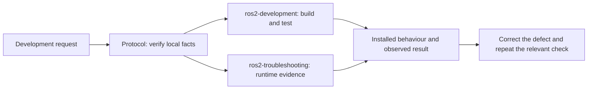

<div align="center">


**Empaquetado contextual de herramientas de verificación, flujos de trabajo y pruebas de traspaso para ROS 2.**


[English](README.md) | [한국어](README.ko.md) | [中文](README.zh.md) | [日本語](README.ja.md) | **Español** | [Français](README.fr.md) | [Deutsch](README.de.md)

</div>

Tres skills para **Claude Code y Codex** dirigidos a **Ubuntu 24.04 / ROS 2 Jazzy**: desarrollar paquetes, verificar pruebas y artefactos instalados, y diagnosticar fallos en tiempo de ejecución.

Este repositorio empaqueta conocimiento de dominio, flujos de trabajo y diagnósticos ejecutables bajo el estándar [Agent Skills](https://agentskills.io/home). En lugar de afirmar que mejora las capacidades intrínsecas de generación de código de los modelos de frontera, este proyecto explora una hipótesis de ingeniería: **empaquetar comprobaciones de evidencia específicas del entorno y registros estructurados de traspaso (handoff) puede reducir la ambigüedad en la verificación y el coste de transferencia de contexto entre sesiones o colaboradores.** Aunque la funcionalidad de las herramientas individuales está validada en pruebas controladas, **la reducción del coste de traspaso y las ganancias globales de productividad siguen siendo hipótesis no demostradas.**

## Inicio rápido

Se admite el descubrimiento automático de skills (skill discovery) en todos los entornos. En Claude Code, elija entre la instalación mediante plugin o la instalación manual.

**Codex — Instalación en un proyecto existente:**

```bash
git clone https://github.com/Leehyunbin0131/claude-ros2-skills.git
python3 claude-ros2-skills/scripts/install.py --agent codex --project /path/to/your-workspace
# O para instalación global de usuario:
# python3 claude-ros2-skills/scripts/install.py --agent codex --user
```

Se instalan en las [rutas documentadas de Codex](https://learn.chatgpt.com/docs/build-skills) (`<proyecto>/.agents/skills` o `~/.agents/skills`), integrando el [protocolo de verificación](CLAUDE.md) compartido al activar el skill. Se conservan `AGENTS.md`, `CLAUDE.md`, la configuración de Codex y otros skills. Consulte las limitaciones de ejecución en sandbox en [evals/CODEX.md](evals/CODEX.md).

**Claude Code — Instalación de plugin:**

```text
/plugin marketplace add Leehyunbin0131/claude-ros2-skills
/plugin install claude-ros2-skills@claude-ros2-skills
```

Al iniciar una nueva sesión, un hook `SessionStart` carga el [protocolo de verificación](CLAUDE.md).

**Claude Code — Instalación manual en un proyecto:**

```bash
git clone https://github.com/Leehyunbin0131/claude-ros2-skills.git
python3 claude-ros2-skills/scripts/install.py --project /path/to/your-workspace
# O para instalación global de usuario:
# python3 claude-ros2-skills/scripts/install.py --user
```

Copia los tres skills y `.claude/rules/ros2-verification.md` preservando archivos existentes. En Ubuntu con ROS 2 Jazzy instalado, puede preparar las dependencias de verificación con:

```bash
sudo apt install python3-colcon-common-extensions python3-pytest \
  ros-jazzy-tf2-ros ros-jazzy-sensor-msgs ros-jazzy-nav-msgs
source /opt/ros/jazzy/setup.bash
```

## Skills disponibles

| Skill | Cuándo ayuda | Qué aporta |
| :--- | :--- | :--- |
| [ros2-development](skills/ros2-development/SKILL.md) | Crear o modificar paquetes, nodos, interfaces, launch, configuración y pruebas | Compilaciones con dependencias, comprobación de artefactos instalados, rechazo de ejecuciones sin pruebas y herramienta opcional de seguimiento de evidencias para traspasos |
| [ros2-troubleshooting](skills/ros2-troubleshooting/SKILL.md) | Fallos de ejecución en publicadores, callbacks, TF, IMU u odometría | Cuatro diagnósticos ejecutables y referencias directas sobre marcos (REP 103/105), QoS y calibración |
| [ros2-microros](skills/ros2-microros/SKILL.md) | Transporte MCU, agente, rclc, memoria de mensajes | Puntos de entrada y guía de diagnóstico; **no validado en hardware MCU** |

## Herramientas ejecutables de verificación y evidencia

Los scripts se incluyen dentro de cada skill. En los ejemplos, `ROS2_SKILL_DIR` es una variable ilustrativa establecida internamente por el agente según el directorio cargado; no requiere entrada del usuario. Son archivos Python estándar (no paquetes para ejecutar con `ros2 run`).

| Script | Propósito y evidencia comprobada |
| :--- | :--- |
| `ros2-development/scripts/check_test_results.py <results> --packages <name>` | Comprueba pruebas ejecutadas y aprobadas en reportes limpios de colcon; use `--require-test PACKAGE::test_name` para exigir la prueba del comportamiento modificado |
| `ros2-development/scripts/evidence.py begin / finish / inspect` | **Flujo opcional (opt-in)**: Registra metadatos declarados por el invocador y compara hashes de archivos y valores de entorno seleccionados para facilitar traspasos |
| `ros2-troubleshooting/scripts/check_qos_compat.py --topic /scan` | Compatibilidad QoS nativa en Jazzy para pares publicador/suscriptor descubiertos |
| `ros2-troubleshooting/scripts/check_tf_tree.py --sensors laser_frame,imu_link` | Conectividad TF y ángulos RPY de montaje para comparación física (los ángulos inusuales son avisos) |
| `ros2-troubleshooting/scripts/check_imu_gravity.py --topic /imu/data` | Gravedad medida sobre +Z en `--base base_link` tras aplicar el TF declarado o `--assume-aligned`; requiere ≥2 muestras; variación RMS >1.5 m/s² (ajustable con `--max-variation`) o TF ausente resulta no concluyente; no demuestra reposo físico ni verifica yaw |
| `ros2-troubleshooting/scripts/check_odom_direction.py --topic /odom` | Dirección de odometría reciente antes y después de un movimiento observado externamente (solo dirección, no calibración de distancia) |

- **Códigos de salida de diagnóstico**: `0` APROBADO (PASS), `1` FALLO (FAIL), `2` NO CONCLUYENTE o solicitud inválida (INCONCLUSIVE).
- **Códigos de salida de inspección de evidencia (`inspect`)**: `0` Coherente (Consistent), `1` Modificado (Changed), `2` Incompleto (Incomplete).

Datos ausentes, NaN, campos IMU no disponibles, menos de dos muestras, variación excesiva de muestras, QoS desconocido, cero pruebas ejecutadas o movimiento insuficiente no se consideran éxito. Los diagnósticos no publican órdenes de movimiento. La herramienta de evidencia separa estrictamente los resultados declarados por el invocador de los hashes observados por la herramienta; no ejecuta comandos del usuario ni garantiza el estado general del robot. Consulte [docs/DESIGN.md](docs/DESIGN.md) y [references/handoff.md](skills/ros2-development/references/handoff.md).

## Cómo funciona



## Resumen de validación y límites de alcance

- **Validación en CI y fixtures**: CI verifica preservación de instalación, sintaxis Python/Shell, envoltorios reales Python/CMake y `ament`, pub/sub y TF sintéticos en Jazzy, contratos de instantáneas de evidencia ([docs/VALIDATION.md](docs/VALIDATION.md)) y controles de oráculo independientes.
- **Aceptación de versión y estudio comparativo**: En sesiones reales con Claude Code **Opus 5.5 High** ([evals/development/RESULTS.md](evals/development/RESULTS.md)), tanto las sesiones con skills como la línea base superaron las mismas tareas. En el estudio de migración de interfaces sobre la instantánea congelada `0.1.2` ([evals/workflow_value/RESULTS.md](evals/workflow_value/RESULTS.md)), las sesiones con skills tuvieron mayor número de tokens de salida y coste estimado de API, mientras que los menores tiempos transcurridos estuvieron sujetos a factores de confusión (orden de ejecución, caché de prompts y esperas de sondas). **No se afirma ninguna ventaja en tokens, coste total o velocidad.** Dicho estudio histórico `0.1.2` no evalúa la herramienta de traspaso introducida en `0.2.0`.
- **Límites no verificados**: Los robots físicos, el firmware MCU, la calibración física y las aplicaciones completas de Nav2/MoveIt/Gazebo permanecen sin verificar.

## Mapa de documentación

| Documento | Propósito |
| :--- | :--- |
| [CLAUDE.md](CLAUDE.md) | Protocolo compartido de verificación ROS 2 Jazzy cargado en las sesiones |
| [docs/DESIGN.md](docs/DESIGN.md) & [docs/VALIDATION.md](docs/VALIDATION.md) | Diseño arquitectónico, contrato CLI y validación operativa de `evidence.py` |
| [evals/VALIDATION.md](evals/VALIDATION.md) & [evals/CODEX.md](evals/CODEX.md) | Inventario de validación `0.1.2` e informe de compatibilidad con Codex |
| [evals/development/RESULTS.md](evals/development/RESULTS.md) & [evals/workflow_value/RESULTS.md](evals/workflow_value/RESULTS.md) | Registros de aceptación en Claude Code y estudio comparativo de migración de interfaces |
| [evals/CAPABILITIES.md](evals/CAPABILITIES.md), [evals/AUTHORING.md](evals/AUTHORING.md), [evals/LADDER.md](evals/LADDER.md) | Conciliación histórica de puntuaciones, criterios de autoría y método de evaluación |
| [CONTRIBUTING.md](CONTRIBUTING.md) | Guía de contribución, niveles de evidencia y comandos de prueba previos a un PR |

## Actualización y licencia

Actualización de plugin: `claude plugin update claude-ros2-skills@claude-ros2-skills`. Para instalaciones manuales, actualice el repositorio y vuelva a ejecutar el comando de instalación (las ediciones locales detienen la actualización para evitar sobrescrituras). Licencia: [Apache-2.0](LICENSE).
