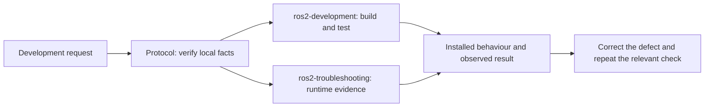

<div align="center">


**Conditionnement contextuel d’outils de vérification, de flux de travail et de preuves de transfert pour ROS 2.**


[English](README.md) | [한국어](README.ko.md) | [中文](README.zh.md) | [日本語](README.ja.md) | [Español](README.es.md) | **Français** | [Deutsch](README.de.md)

</div>

Trois skills pour **Claude Code et Codex** ciblant **Ubuntu 24.04 / ROS 2 Jazzy** : développer des paquets, vérifier les tests et les artefacts installés, et diagnostiquer les pannes à l’exécution.

Ce dépôt regroupe des connaissances de domaine, des flux de travail ciblés et des outils de diagnostic exécutables selon le standard [Agent Skills](https://agentskills.io/home). Plutôt que de revendiquer une amélioration des capacités intrinsèques de génération de code des modèles de pointe, ce projet explore une hypothèse d'ingénierie : **le conditionnement de vérifications de preuves spécifiques à l'environnement et d'enregistrements structurés de transfert (handoff) peut réduire l'ambiguïté de vérification et le coût de transfert de contexte entre sessions ou collaborateurs.** Bien que la fonctionnalité individuelle des outils soit validée sur des bancs d’essai, **la réduction du coût de transfert et les gains globaux de productivité restent des hypothèses non prouvées.**

## Démarrage rapide

La détection automatique des skills (skill discovery) est prise en charge dans tous les environnements. Dans Claude Code, choisissez soit le plugin, soit l'installation manuelle.

**Codex — Installation dans un projet existant :**

```bash
git clone https://github.com/Leehyunbin0131/claude-ros2-skills.git
python3 claude-ros2-skills/scripts/install.py --agent codex --project /path/to/your-workspace
# Ou installation globale pour l'utilisateur :
# python3 claude-ros2-skills/scripts/install.py --agent codex --user
```

Les skills s'installent dans les [emplacements documentés de Codex](https://learn.chatgpt.com/docs/build-skills) (`<projet>/.agents/skills` ou `~/.agents/skills`), en intégrant le [protocole de vérification](CLAUDE.md) commun lors de l'activation du skill. Les fichiers `AGENTS.md`, `CLAUDE.md`, la configuration existante et les autres skills sont préservés. Voir les limites d'exécution en bac à sable dans [evals/CODEX.md](evals/CODEX.md).

**Claude Code — Installation du plugin :**

```text
/plugin marketplace add Leehyunbin0131/claude-ros2-skills
/plugin install claude-ros2-skills@claude-ros2-skills
```

Au démarrage d'une nouvelle session, un hook `SessionStart` transmet le [protocole de vérification](CLAUDE.md).

**Claude Code — Installation manuelle dans un projet :**

```bash
git clone https://github.com/Leehyunbin0131/claude-ros2-skills.git
python3 claude-ros2-skills/scripts/install.py --project /path/to/your-workspace
# Ou installation globale pour l'utilisateur :
# python3 claude-ros2-skills/scripts/install.py --user
```

Copie les trois skills ainsi que `.claude/rules/ros2-verification.md` tout en préservant les fichiers existants. Sur un système Ubuntu disposant déjà de ROS 2 Jazzy, installez les dépendances des outils de vérification avec :

```bash
sudo apt install python3-colcon-common-extensions python3-pytest \
  ros-jazzy-tf2-ros ros-jazzy-sensor-msgs ros-jazzy-nav-msgs
source /opt/ros/jazzy/setup.bash
```

## Skills disponibles

| Skill | Quand l'utiliser | Ce qu'il apporte |
| :--- | :--- | :--- |
| [ros2-development](skills/ros2-development/SKILL.md) | Créer ou modifier paquets, nœuds, interfaces, launch, configurations et tests | Compilations tenant compte des dépendances, vérification des artefacts installés, détection des exécutions sans tests, et outil optionnel de suivi des preuves pour les transferts |
| [ros2-troubleshooting](skills/ros2-troubleshooting/SKILL.md) | Pannes d'exécution des publications, callbacks, TF, IMU ou odométrie | Quatre diagnostics exécutables et références directes sur les repères (REP 103/105), la QoS et l'étalonnage |
| [ros2-microros](skills/ros2-microros/SKILL.md) | Transport MCU, agent, rclc, gestion mémoire | Points d'entrée et guides de diagnostic ; **non validé sur matériel MCU** |

## Outils exécutables de vérification et de preuve

Les scripts sont inclus dans chaque skill. Dans les exemples, `ROS2_SKILL_DIR` est une variable illustrative définie en interne par l'agent vers le répertoire du skill chargé ; elle ne nécessite aucune intervention de l'utilisateur. Ce sont de simples fichiers Python (non invocables via `ros2 run`).

| Script | Rôle et preuve vérifiée |
| :--- | :--- |
| `ros2-development/scripts/check_test_results.py <results> --packages <name>` | Vérifie les tests exécutés et réussis dans les rapports récents colcon ; utilisez `--require-test PACKAGE::test_name` pour exiger le test du comportement modifié |
| `ros2-development/scripts/evidence.py begin / finish / inspect` | **Flux optionnel (opt-in)** : Enregistre les métadonnées déclarées par l'appelant et compare les hachages de fichiers ainsi que les valeurs d'environnement sélectionnées pour faciliter le transfert |
| `ros2-troubleshooting/scripts/check_qos_compat.py --topic /scan` | Compatibilité QoS Jazzy native entre paires de publication/abonnement découvertes |
| `ros2-troubleshooting/scripts/check_tf_tree.py --sensors laser_frame,imu_link` | Connectivité TF et angles RPY de montage pour comparaison physique (les angles inhabituels sont signalés à titre indicatif) |
| `ros2-troubleshooting/scripts/check_imu_gravity.py --topic /imu/data` | Gravité mesurée sur +Z dans `--base base_link` après TF déclaré ou `--assume-aligned` ; requiert ≥2 échantillons ; une variation RMS >1,5 m/s² (ajustable via `--max-variation`) ou un TF manquant est non conclusif ; ne prouve ni l'immobilité physique ni le yaw |
| `ros2-troubleshooting/scripts/check_odom_direction.py --topic /odom` | Direction de l'odométrie récente avant et après un mouvement observé extérieurement (direction uniquement, pas d'étalonnage de distance) |

- **Codes de sortie de diagnostic** : `0` SUCCÈS (PASS), `1` ÉCHEC (FAIL), `2` NON CONCLUSIF ou requête invalide (INCONCLUSIVE).
- **Codes de sortie de l'inspection de preuve (`inspect`)** : `0` Cohérent (Consistent), `1` Modifié (Changed), `2` Incomplet (Incomplete).

Données absentes, NaN, champs IMU indisponibles, moins de deux échantillons, variation excessive d'échantillons, QoS indéterminée, aucun test exécuté ou mouvement insuffisant ne constituent pas un succès. Les diagnostics ne publient pas de commandes de mouvement. L'outil de preuve sépare strictement les résultats déclarés par l'appelant des hachages observés par l'outil ; il n'exécute pas les commandes utilisateur et ne garantit pas l'état global du robot. Voir [docs/DESIGN.md](docs/DESIGN.md) et [references/handoff.md](skills/ros2-development/references/handoff.md).

## Fonctionnement



## Résumé de validation et limites de portée

- **Validation CI et bancs d'essai** : La CI vérifie la préservation à l'installation, la syntaxe Python/Shell, les wrappers de tests Python/CMake et `ament` réels, les communications et TF synthétiques sur Jazzy, les contrats d'instantanés de preuve ([docs/VALIDATION.md](docs/VALIDATION.md)) ainsi que les contrôles d'oracle indépendants.
- **Recette et étude comparative** : Lors des sessions d'évaluation avec Claude Code **Opus 5.5 High** ([evals/development/RESULTS.md](evals/development/RESULTS.md)), les sessions avec skills et la référence ont réussi les mêmes tâches. Dans l'étude de migration d'interfaces sur l'instantané figé `0.1.2` ([evals/workflow_value/RESULTS.md](evals/workflow_value/RESULTS.md)), les sessions avec skills ont consommé plus de tokens de sortie et présenté un coût API estimé supérieur, tandis que la réduction du temps écoulé était biaisée par l'ordre d'exécution, le cache de prompt et les attentes de sondes. **Aucun avantage en tokens, coût total ou vitesse n'est revendiqué.** Cette étude historique `0.1.2` n'évalue pas le nouvel outil de transfert de la version `0.2.0`.
- **Périmètre non vérifié** : Les robots réels, les micrologiciels MCU, l'étalonnage physique et les applications Nav2/MoveIt/Gazebo complètes restent non vérifiés.

## Plan de la documentation

| Document | Objectif |
| :--- | :--- |
| [CLAUDE.md](CLAUDE.md) | Protocole commun de vérification ROS 2 Jazzy chargé dans les sessions d'agent |
| [docs/DESIGN.md](docs/DESIGN.md) & [docs/VALIDATION.md](docs/VALIDATION.md) | Architecture, contrat CLI et validation opérationnelle de l'outil `evidence.py` |
| [evals/VALIDATION.md](evals/VALIDATION.md) & [evals/CODEX.md](evals/CODEX.md) | Inventaire de validation `0.1.2` et rapport de compatibilité Codex |
| [evals/development/RESULTS.md](evals/development/RESULTS.md) & [evals/workflow_value/RESULTS.md](evals/workflow_value/RESULTS.md) | Résultats de recette Claude Code et étude comparative de migration d'interfaces |
| [evals/CAPABILITIES.md](evals/CAPABILITIES.md), [evals/AUTHORING.md](evals/AUTHORING.md), [evals/LADDER.md](evals/LADDER.md) | Réconciliation des scores historiques, critères de rédaction et méthode d'évaluation |
| [CONTRIBUTING.md](CONTRIBUTING.md) | Guide de contribution, exigences de preuve et commandes de test avant PR |

## Mise à jour et licence

Mise à jour du plugin : `claude plugin update claude-ros2-skills@claude-ros2-skills`. Pour une installation manuelle, mettez à jour le dépôt et relancez la commande d'installation (les modifications locales bloquent la mise à jour pour éviter tout écrasement). Licence : [Apache-2.0](LICENSE).
