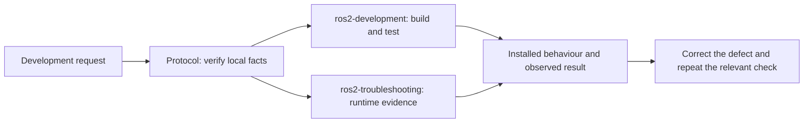

<div align="center">


**ROS 2 検証ツール、ワークフロー、引き継ぎ証拠のコンテキストに応じたパッケージング。**


[English](README.md) | [한국어](README.ko.md) | [中文](README.zh.md) | **日本語** | [Español](README.es.md) | [Français](README.fr.md) | [Deutsch](README.de.md)

</div>

**Ubuntu 24.04 / ROS 2 Jazzy** を対象とした Claude Code および Codex 向けの3つのスキルを提供します：パッケージ開発、テストとインストール成果物の検証、実行時障害の診断。

本リポジトリは、[Agent Skills 標準](https://agentskills.io/home) に準拠し、ドメイン知識、開発ワークフロー、実行可能な診断ツールをパッケージングします。先端言語モデル本来のコーディング能力向上を主張するのではなく、**環境固有の証拠確認と構造化された引き継ぎ記録により、検証の曖昧さやセッション間の引き継ぎコストを削減できるかを探る設計仮説**に基づいています。ツール自体の機能はテストフィクスチャで確認されていますが、**引き継ぎコストの削減や総合的な生産性の向上は未検証の仮説です。**

## クイックスタート

すべての環境で自動スキル検出（skill discovery）を標準サポートしています。Claude Code ではプラグインまたは手動インストールのいずれか一方を選択してください。

**Codex — 既存プロジェクトへのインストール:**

```bash
git clone https://github.com/Leehyunbin0131/claude-ros2-skills.git
python3 claude-ros2-skills/scripts/install.py --agent codex --project /path/to/your-workspace
# ユーザー全体に適用する場合:
# python3 claude-ros2-skills/scripts/install.py --agent codex --user
```

[Codex 公式スキルパス](https://learn.chatgpt.com/docs/build-skills)（`<project>/.agents/skills` または `~/.agents/skills`）に配置され、スキル有効化時に共通の [検証プロトコル](CLAUDE.md) が読み込まれます。既存の `AGENTS.md`、`CLAUDE.md`、Codex 設定や他のスキルは保持されます。サンドボックス環境での実行時制限については [evals/CODEX.md](evals/CODEX.md) を参照してください。

**Claude Code — プラグインインストール:**

```text
/plugin marketplace add Leehyunbin0131/claude-ros2-skills
/plugin install claude-ros2-skills@claude-ros2-skills
```

新しいセッションを開始すると、`SessionStart` フックが [検証プロトコル](CLAUDE.md) を伝達します。

**Claude Code — 既存プロジェクトへの手動インストール:**

```bash
git clone https://github.com/Leehyunbin0131/claude-ros2-skills.git
python3 claude-ros2-skills/scripts/install.py --project /path/to/your-workspace
# ユーザー全体に適用する場合:
# python3 claude-ros2-skills/scripts/install.py --user
```

3つのスキルと `.claude/rules/ros2-verification.md` がインストールされ、既存の `CLAUDE.md` や他のスキルは保持されます。Jazzy が導入済みの Ubuntu では、診断ツールの依存パッケージを以下のコマンドで準備できます：

```bash
sudo apt install python3-colcon-common-extensions python3-pytest \
  ros-jazzy-tf2-ros ros-jazzy-sensor-msgs ros-jazzy-nav-msgs
source /opt/ros/jazzy/setup.bash
```

## スキル一覧

| スキル | 用途 | 提供内容 |
| :--- | :--- | :--- |
| [ros2-development](skills/ros2-development/SKILL.md) | パッケージ、ノード、インターフェース、launch、設定、テストの開発 | 依存関係を考慮したビルド、インストール成果物の検証、空テスト実行の検出、引き継ぎのためのオプトイン証拠追跡ツール |
| [ros2-troubleshooting](skills/ros2-troubleshooting/SKILL.md) | トピック、コールバック、TF、IMU、オドメトリの実行時障害 | 4つの実行可能診断ツール、座標系（REP 103/105）、QoS、実機キャリブレーション参照 |
| [ros2-microros](skills/ros2-microros/SKILL.md) | MCU通信、エージェント、rclc、メッセージメモリ | ソース参照および診断ガイダンス（**MCU実機未検証**） |

## 実行可能検証および証拠ツール

各スクリプトはスキル内に配置されています。例にある `ROS2_SKILL_DIR` はエージェントがロードされたスキルのディレクトリに内部設定する変数であり、ユーザーに入力を求めるものではありません。`ros2 run` で起動するパッケージではなく通常の Python スクリプトです。

| スクリプト | 目的と確認証拠 |
| :--- | :--- |
| `ros2-development/scripts/check_test_results.py <results> --packages <name>` | 新規 colcon 結果から実際に実行・成功したテストを確認。機能変更には `--require-test PACKAGE::test_name` で対象テストを指定（リンターのみの通過を排除） |
| `ros2-development/scripts/evidence.py begin / finish / inspect` | **オプトインワークフロー**: 宣言されたコマンドメタデータの記録およびワークスペースのファイルハッシュと選択された環境変数値の比較による引き継ぎ支援 |
| `ros2-troubleshooting/scripts/check_qos_compat.py --topic /scan` | 発見された発行者・購読者ペアのネイティブ Jazzy QoS 互換性 |
| `ros2-troubleshooting/scripts/check_tf_tree.py --sensors laser_frame,imu_link` | TF 接続性および実機比較用の取り付け RPY 角度（特殊な角度の警告は参考表示） |
| `ros2-troubleshooting/scripts/check_imu_gravity.py --topic /imu/data` | 宣言された TF または `--assume-aligned` 適用後、水平基準フレーム（`--base base_link`）での +Z 重力測定値を確認。最低2サンプル必要。RMS 変動 >1.5 m/s²（`--max-variation` で調整可）または TF 欠落時は判定不能。物理的静止や yaw は証明不可 |
| `ros2-troubleshooting/scripts/check_odom_direction.py --topic /odom` | 外部で観測された移動前後の新規オドメトリ進行方向（方向検査のみ、距離校正は対象外） |

- **診断スクリプト終了コード**: `0` 合格（PASS）、`1` 失敗（FAIL）、`2` 判定不能または無効な要求（INCONCLUSIVE）。
- **証拠検査（`inspect`）終了コード**: `0` 一致（Consistent）、`1` 変更あり（Changed）、`2` 不完全（Incomplete）。

欠落データ、NaN、使用不可の IMU フィールド、サンプル不足（2件未満）、過大なサンプル変動、不明な QoS、テスト未実行、移動量不足は成功として扱いません。実行時検査は移動指令を送信しません。証拠ツールは呼び出し側が宣言した結果とツールが観測したファイルハッシュを厳格に分離し、ユーザーコマンドの実行・再実行やロボット全体の正常性保証は行いません。詳細は [docs/DESIGN.md](docs/DESIGN.md) および [references/handoff.md](skills/ros2-development/references/handoff.md) を参照してください。

## 開発フロー



## 検証範囲と適用限界

- **CI およびフィクスチャ検証**: インストール保持、Python/Shell 構文、実際の Python/CMake・`ament` テストラッパー、合成 Jazzy 通信・TF、証拠スナップショット契約（[docs/VALIDATION.md](docs/VALIDATION.md)）、独立した評価オラクルを自動検証します。
- **受入検証および比較実験**: Claude Code **Opus 5.5 High** による受入検証（[evals/development/RESULTS.md](evals/development/RESULTS.md)）では、スキル適用群とベースライン群の双方が課題を完了しました。凍結された `0.1.2` スナップショットでのインターフェース変更比較実験（[evals/workflow_value/RESULTS.md](evals/workflow_value/RESULTS.md)）では、スキル適用セッションで出力トークン数と推定 API コストが増加し、観測された経過時間の短縮には実行順序・プロンプトキャッシュ・プローブ待機の交絡が含まれます。**トークン数、総コスト、速度の優位性は実証されておらず、主張しません。** また過去の `0.1.2` 研究は `0.2.0` の引き継ぎツールを評価していません。
- **未検証領域**: 実機ロボット、MCU ファームウェア、物理キャリブレーション、および Nav2・MoveIt・Gazebo の全体アプリケーションは未検証です。

## ドキュメント案内

| ドキュメント | 内容 |
| :--- | :--- |
| [CLAUDE.md](CLAUDE.md) | エージェントセッションに読み込まれる共通 ROS 2 Jazzy 検証プロトコル |
| [docs/DESIGN.md](docs/DESIGN.md) & [docs/VALIDATION.md](docs/VALIDATION.md) | `evidence.py` 引き継ぎツールの設計根拠、CLI 契約、および検証サマリー |
| [evals/VALIDATION.md](evals/VALIDATION.md) & [evals/CODEX.md](evals/CODEX.md) | `0.1.2` 開発・診断ワークフローの検証一覧と Codex 互換性レポート |
| [evals/development/RESULTS.md](evals/development/RESULTS.md) & [evals/workflow_value/RESULTS.md](evals/workflow_value/RESULTS.md) | Claude Code リリース受入記録およびインターフェース変更比較実験 |
| [evals/CAPABILITIES.md](evals/CAPABILITIES.md)、[evals/AUTHORING.md](evals/AUTHORING.md)、[evals/LADDER.md](evals/LADDER.md) | 過去の評価スコア照合記録、スキル作成基準、および難易度ラダー評価手法 |
| [CONTRIBUTING.md](CONTRIBUTING.md) | コントリビューション基準、証拠レベル定義、PR 前の全テストコマンド |

## アップデート & ライセンス

プラグインの更新：`claude plugin update claude-ros2-skills@claude-ros2-skills`。手動インストールの場合はリポジトリを更新して同じインストールコマンドを再実行してください（ローカル変更がある場合は上書きせず停止します）。ライセンス：[Apache-2.0](LICENSE)。
