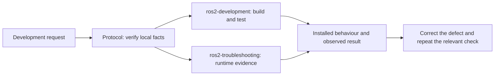

<div align="center">


**ROS 2 검증 도구, 작업 흐름, 인계 증거의 상황별 패키징.**


[English](README.md) | **한국어** | [中文](README.zh.md) | [日本語](README.ja.md) | [Español](README.es.md) | [Français](README.fr.md) | [Deutsch](README.de.md)

</div>

**Ubuntu 24.04 / ROS 2 Jazzy** 환경에서 패키지를 개발하고, 테스트와 설치 산출물을 확인하며, 런타임 오류를 진단하는 Claude Code·Codex 스킬 3종을 제공합니다.

이 저장소는 [Agent Skills 표준](https://agentskills.io/home)에 따라 도메인 지식, 워크플로, 실행 진단 도구를 패키징합니다. 최신 언어 모델의 코딩 능력을 향상시킨다고 주장하는 대신, **환경별 근거와 검증 단계를 구조화하고 인계(handoff) 기록을 남김으로써 세션 간 검증 모호성과 인계 비용을 줄일 수 있는지 탐구하는 설계 가설**을 검증합니다. 개별 도구의 동작 기능은 테스트 픽스처로 확인되었으나, **인계 비용 절감이나 전반적인 개발 생산성 향상은 입증되지 않은 가설**입니다.

## 빠른 시작

사용할 도구를 선택하세요. 환경 전반에서 스킬 자동 검색(skill discovery)이 기본 지원됩니다. Claude Code에서는 플러그인과 수동 설치 중 하나만 사용하세요.

**Codex — 이미 존재하는 프로젝트에 설치:**

```bash
git clone https://github.com/Leehyunbin0131/claude-ros2-skills.git
python3 claude-ros2-skills/scripts/install.py --agent codex --project /path/to/your-workspace
# 모든 프로젝트에 적용하려면 위 명령 대신 실행
# python3 claude-ros2-skills/scripts/install.py --agent codex --user
```

[Codex 공식 스킬 경로](https://learn.chatgpt.com/docs/build-skills)인
`<프로젝트>/.agents/skills` 또는 `~/.agents/skills`에 설치합니다. 중복 표시를 피하려면
두 범위 중 하나만 선택하세요. 각 스킬에 공통 [검증 프로토콜](CLAUDE.md)을 포함하므로
Codex가 스킬을 사용할 때 지침도 함께 읽습니다. Claude 훅이나 규칙 파일에 의존하지 않습니다.
기존 `AGENTS.md`, `CLAUDE.md`, Codex 설정과 다른 스킬은 보존하며, 로컬 수정이 있으면
업데이트를 중단합니다. 대상 작업 공간에서 새 Codex 세션을 시작하세요.
CLI·IDE에서는 `$ros2-development`, `$ros2-troubleshooting`으로 명시적으로 호출할 수 있고,
데스크톱에서는 스킬 선택기에서 같은 이름을 선택하면 됩니다.

실시간 ROS 검사는 대상 ROS 그래프에 접근할 수 있어야 합니다. 제한된 Codex 환경에서
ROS 로그 경로 쓰기가 거부되면 `ROS_LOG_DIR`를 작업 공간의 쓰기 가능한 폴더로 지정할 수 있습니다.
토픽은 보이지만 메시지가 오지 않는 경우 샌드박스·DDS 통신 제약도 확인해야 합니다.
프로젝트의 도메인과 탐색 범위를 유지하세요. `SUBNET`으로 확대하는 것을 일반적인 설치 해결책으로
사용하지 않습니다. 관측할 수 없으면 판정 불가로 보고해야 합니다. [실행 중 확인한 제한](evals/CODEX.md).

**플러그인 — Claude Code 세션에서 실행:**

```text
/plugin marketplace add Leehyunbin0131/claude-ros2-skills
/plugin install claude-ros2-skills@claude-ros2-skills
```

새 세션을 시작하면 `SessionStart` 훅이 [검증 프로토콜](CLAUDE.md)을 전달합니다.
플러그인 루트의 `CLAUDE.md`는 그 자체로 자동 로드되지 않습니다.
기본 사용자 범위 설치는 모든 프로젝트에 적용됩니다. ROS 작업 공간에만 적용하려면 프로젝트 설치를 사용하세요.

**Claude Code 수동 — 이미 존재하는 프로젝트에 설치:**

```bash
git clone https://github.com/Leehyunbin0131/claude-ros2-skills.git
python3 claude-ros2-skills/scripts/install.py --project /path/to/your-workspace
# 모든 프로젝트에 적용하려면 위 명령 대신 실행
# python3 claude-ros2-skills/scripts/install.py --user
```

스킬 3개와 `.claude/rules/ros2-verification.md`가 설치됩니다.
기존 `CLAUDE.md`와 다른 스킬은 보존합니다. 사용자가 수정한 파일은 덮어쓰지 않으며,
예전에 설치한 폐기 스킬은 검토할 수 있도록 알려줍니다. 설치 후 Claude Code를 다시 시작하세요.
ROS, colcon, 로봇 드라이버는 설치하지 않으므로 작업 공간에 필요한 의존성은 별도로 준비해야 합니다.
이미 Jazzy가 설치된 Ubuntu에서는 검사 도구의 의존성을 다음과 같이 준비할 수 있습니다.

```bash
sudo apt install python3-colcon-common-extensions python3-pytest \
  ros-jazzy-tf2-ros ros-jazzy-sensor-msgs ros-jazzy-nav-msgs
source /opt/ros/jazzy/setup.bash
```

Ubuntu/Jazzy에서 제공하는 테스트 도구나 별도로 검증한 환경을 사용하세요.
검증 당시 Jazzy의 `launch_testing`은 pytest 9에서 시작 오류가 났으며,
ROS 환경을 포함한 검사는 Ubuntu의 pytest 7.4.4로 확인했습니다.
테스트 실행기 오류와 구현의 검증 실패를 구분해야 합니다.

## 스킬과 사용 예시

| 스킬 | 사용할 때 | 제공하는 내용 |
| :--- | :--- | :--- |
| [ros2-development](skills/ros2-development/SKILL.md) | 패키지·노드·인터페이스·launch·설정·테스트 개발 | 의존성을 고려한 빌드, 설치 산출물 검증, 실제 실행된 테스트가 없는 상태 탐지, 작업 인계를 위한 선택적 증거 추적 도구 |
| [ros2-troubleshooting](skills/ros2-troubleshooting/SKILL.md) | 토픽·콜백·TF·IMU·오도메트리의 실행 오류 | 실행 가능한 진단 4개와 좌표계(REP 103/105)·QoS·실물 보정 참고 자료 |
| [ros2-microros](skills/ros2-microros/SKILL.md) | MCU 통신·에이전트·rclc·메시지 메모리 작업 | 소스와 진단 지침; **MCU 하드웨어에서 검증되지 않음** |

두 도구 모두 설명을 보고 필요한 스킬을 자동으로 선택할 수 있습니다. 명시적으로 사용하려면 요청에 이름을 넣으세요.

- “ros2-development를 사용해서 기존 Jazzy 패키지에 서비스를 추가해줘. 소비 패키지도 빌드하고 관련 테스트와 설치된 노드 실행을 확인해줘.”
- “ros2-troubleshooting을 사용해줘. `/scan`은 발행되는데 내 노드의 콜백이 실행되지 않아. 호환되지 않는 엔드포인트를 찾고 수정 결과도 확인해줘.”
- “수평으로 놓인 로봇에서 IMU를 뒤집어 장착했어. 선언된 TF를 적용해서 정상 장착과 실제 오류를 구분해줘.”

알고 있다면 실물/시뮬레이션 여부와 작업 공간을 함께 알려주세요.
로봇의 실제 치수나 기존 토픽·TF 발행자가 불명확하면 에이전트가 이를 확인해야 합니다.

## 검사 및 증거 도구

스크립트는 각 스킬에 포함됩니다. 예제의 `ROS2_SKILL_DIR`는 에이전트가 로드된 스킬 디렉터리를 가리키도록 설정하는 예시 변수이며, 사용자에게 입력을 요구하지 않습니다.
`ros2 run`으로 실행하는 ROS 패키지가 아닌 일반 Python 파일입니다.

| 스크립트 | 확인하는 증거 |
| :--- | :--- |
| `ros2-development/scripts/check_test_results.py <results> --packages <name>` | 새 colcon 결과에서 실행·통과한 테스트 확인. 기능 변경은 `--require-test PACKAGE::test_name`으로 필요한 테스트를 지정. 스타일 검사만으로 기능 검증을 대신하지 않음 |
| `ros2-development/scripts/evidence.py begin / finish / inspect` | **선택적(opt-in) 워크플로**: 호출자가 선언한 명령 메타데이터 기록 및 작업 공간의 파일 해시와 선택된 환경변수 값 비교로 인계 지원 |
| `ros2-troubleshooting/scripts/check_qos_compat.py --topic /scan` | 발견된 발행자·구독자 조합의 실제 Jazzy QoS 호환성 |
| `ros2-troubleshooting/scripts/check_tf_tree.py --sensors laser_frame,imu_link` | TF 연결과 실물에 대조할 장착 각도. 특이한 각도 표시는 참고 사항 |
| `ros2-troubleshooting/scripts/check_imu_gravity.py --topic /imu/data` | 선언된 TF 또는 `--assume-aligned`를 적용하여 수평 기준 프레임의 +Z 중력 가속도 측정치 확인. 최소 2개 샘플 필요, 샘플 간 RMS 편차 >1.5 m/s²(`--max-variation`으로 조정 가능) 또는 TF 누락 시 판정 불가. 어느 방식이든 물리적 정지 상태 자체는 입증하지 못하며 중력만으로 yaw 확인 불가 |
| `ros2-troubleshooting/scripts/check_odom_direction.py --topic /odom` | 외부에서 확인한 이동 전후의 새로운 오도메트리. 방향 검사이며 거리 보정 검사는 아님 |

아래 4개 스크립트는 `ros2-troubleshooting/scripts/`에 있습니다.
**진단 스크립트 종료 코드: 0 통과, 1 실패, 2 판정 불가 또는 잘못된 요청.**

**증거 검사(`inspect`) 종료 코드: 0 일치(Consistent), 1 변경됨(Changed), 2 불완전(Incomplete).**

데이터 누락·NaN·사용 불가 IMU 필드·불충분한 샘플(2개 미만)·과도한 샘플 편차·불명확한 QoS·실행한 테스트 없음·불충분한 이동을 성공으로 처리하지 않습니다. 런타임 검사는 Jazzy 환경을 먼저 불러와야 합니다. 이동 명령을 발행하지 않으며, 오도메트리 검사는 스크립트 외부에서 수행한 이동을 관찰합니다. 검사 결과는 관측한 속성에 관한 근거만 제공합니다. IMU 통과(PASS)는 선언된 TF 또는 명시적인 축 정렬 가정을 거쳐 수평 기준 프레임에서 측정된 +Z 중력 방향을 확인할 뿐이며, 물리적 정지 상태나 로봇 전체의 정상 상태를 입증하지는 못합니다.

증거 도구는 호출자가 선언한 출력과 도구가 관측한 파일 해시를 엄격히 분리합니다. 사용자 명령을 직접 실행하거나 재실행하지 않으며, 신선도를 보장하거나 중간 변경의 부재, 로봇 전체의 정상 작동을 증명하지 않습니다. 상세 설계는 [docs/DESIGN.md](docs/DESIGN.md) 및 [references/handoff.md](skills/ros2-development/references/handoff.md)를 참고하세요.

## 개발 흐름



프로토콜로 로컬 API와 전제를 확인하고, `ros2-development`로 패키지 의존성과 테스트를 검증합니다.
실행 중 문제가 있으면 `ros2-troubleshooting`으로 관측하고, 수정 후 같은 검사를 다시 실행합니다.
Nav2·MoveIt·ros2_control을 포함한 개발에서도 이 흐름을 활용하되, 프로젝트에 맞는 실행 증거를 선택합니다.

새 개발 스킬이 다루는 구체적인 문제는 **실행한 테스트가 0개인데 명령이 성공하는 경우**입니다.
실제 임시 패키지 검증에서 기본 `colcon` 명령은 0으로 종료했지만 새 검사는 2로 종료해 완료 증거가 없음을 표시했습니다.

## 검증 요약 및 적용 경계

- **CI 및 픽스처 검증**: 설치·업데이트 시 파일 보존, Python·셸 문법, 결정론적 판정 로직, 실제 Python/CMake 및 `ament` 테스트 래퍼, 합성 Jazzy 통신·TF, 인계 증거 스냅샷 계약([docs/VALIDATION.md](docs/VALIDATION.md)), 독립적인 평가 오라클(정상·오류 대조군)을 자동 검사합니다. 실행 명령은 [CONTRIBUTING.md](CONTRIBUTING.md)에 있습니다.
- **배포 수락 검증 (Claude Code)**: 실제 **Opus 5.5 High** 세션으로 네임스페이스 센서 패키지 개발, 휠 속도 회귀 테스트 수정, 실시간 IMU/TF 진단 과제를 플러그인·수동 설치 방식에서 각각 완료하고 지침 전달 및 스크립트 실행을 확인했습니다([evals/development/RESULTS.md](evals/development/RESULTS.md)). 스킬 없는 기본(baseline) 실행도 세 과제를 모두 통과했으며, 이는 방식·과제당 1회(`n=1`)의 동작 확인일 뿐 **성능 향상이나 동등한 신뢰성을 입증하지 않습니다.**
- **Codex 호환성 검증**: 22개 오프라인 설치·탐색 테스트와 프로젝트 설치 워크플로 2건(모델명 미기록)을 [evals/CODEX.md](evals/CODEX.md)에 기록합니다. Codex 설치본은 세션 시작 훅 대신 스킬 활성화 시점에 공통 지침을 포함합니다.
- **인터페이스 변경 비교 실험 및 비주장(Non-claims)**: 동결된 `0.1.2` 스냅샷에서 Opus 5.5 High로 Python·C++ 소비자가 있는 세 변형을 스킬 유무에 따라 비교한 결과([evals/workflow_value/RESULTS.md](evals/workflow_value/RESULTS.md)), 여섯 결과물 모두 독립적인 클린 빌드·런타임·회귀 검증을 통과했습니다. 스킬 팩 세션은 출력 토큰 수와 추정 API 비용이 더 높았으며, 관측된 경과 시간 단축은 실행 순서·프롬프트 캐시·백그라운드 프로브 대기가 혼재된 결과입니다. **토큰 수, 총 비용, 속도 측면의 이점은 입증되지 않았으며 이를 주장하지 않습니다.** 또한 과거 `0.1.2` 연구는 `0.2.0`의 인계 증거 도구를 평가하지 않습니다.
- **미검증 범위**: 실물 로봇, MCU 펌웨어, 물리 보정, 그리고 Nav2·MoveIt·Gazebo 전체 애플리케이션은 검증하지 않았습니다. 소규모 픽스처 결과로 일반적인 오래된 오버레이(stale overlay) 복구, 구형·신형 DDS 타입 간 호환성, 외부 C++ 라이브러리 연동, `--packages-up-to` 지침의 인과적 효과까지 입증한 것은 아닙니다.
- **유지보수 기준**: 지원 범위 내의 구체적인 결함, 필수 테스트 회귀, 확인된 실행 환경 호환성 변화, 명시적인 사용자 범위 확장이 있을 때만 재개하며, 업스트림 모델 업데이트만으로는 재개하지 않습니다.

## 문서 구성 및 안내

| 문서 | 설명 |
| :--- | :--- |
| [CLAUDE.md](CLAUDE.md) | 에이전트 세션에 전달되는 공통 ROS 2 Jazzy 검증 프로토콜 |
| [docs/DESIGN.md](docs/DESIGN.md) | 작업 인계 증거 도구(`evidence.py`)의 아키텍처, 설계 트레이드오프 및 CLI 계약 |
| [docs/VALIDATION.md](docs/VALIDATION.md) | `0.2.0` 인계 증거 도구의 계약 테스트 및 정성적 스모크 검증 요약 |
| [evals/VALIDATION.md](evals/VALIDATION.md) | `0.1.2` 개발 워크플로 및 런타임 진단 도구의 기능 검증 내역 |
| [evals/development/RESULTS.md](evals/development/RESULTS.md) | Claude Code 배포 수락 검증 기록 (플러그인·수동·베이스라인 실행) |
| [evals/CODEX.md](evals/CODEX.md) | Codex 스킬 설치, 탐색 검사 및 샌드박스 런타임 관측 보고서 |
| [evals/workflow_value/RESULTS.md](evals/workflow_value/RESULTS.md) | 인터페이스 변경 비교 실험 결과 (`0.1.2` 스냅샷) |
| [evals/CAPABILITIES.md](evals/CAPABILITIES.md) | 과거 베이스라인 평가 점수와 커밋된 판정 기록 간의 대조표 (현재 성능으로 홍보하지 않음) |
| [evals/AUTHORING.md](evals/AUTHORING.md) & [evals/LADDER.md](evals/LADDER.md) | 스킬 작성 기준 및 사전 등록형 난이도 사다리(Difficulty Ladder) 평가 방법론 |
| [CONTRIBUTING.md](CONTRIBUTING.md) | 기여에 필요한 증거 수준, 구현 규칙 및 PR 전 전체 테스트 명령어 |

## 업데이트

플러그인 설치는 다음 명령을 사용합니다.

```bash
claude plugin update claude-ros2-skills@claude-ros2-skills
```

수동 설치는 저장소를 갱신한 뒤 같은 설치 명령을 다시 실행합니다.
로컬 수정이 있으면 덮어쓰지 않고 중단하므로 먼저 충돌을 검토하세요.
Codex는 `--agent codex`를 추가해 다시 실행합니다. 이후 새 세션을 시작하세요.

## 기여 및 라이선스

[CONTRIBUTING.md](CONTRIBUTING.md) · [Apache-2.0](LICENSE).
정확성 수정, 실용적인 개발 흐름, 재현 가능한 실패 사례를 환영합니다.
