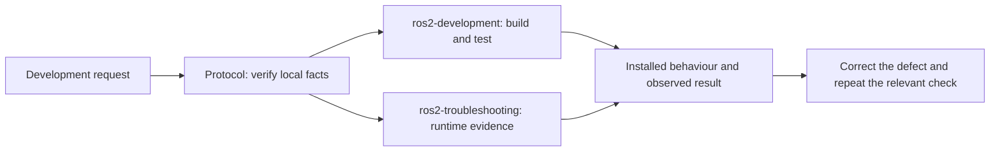

<div align="center">


**Contextual packaging of ROS 2 verification tools, workflows, and handoff evidence.**


**English** | [한국어](README.ko.md) | [中文](README.zh.md) | [日本語](README.ja.md) | [Español](README.es.md) | [Français](README.fr.md) | [Deutsch](README.de.md)

</div>

Three skills for **Claude Code and Codex**, targeting **Ubuntu 24.04 / ROS 2 Jazzy**: develop packages,
verify tests and installed behaviour, and diagnose runtime faults.

This repository packages contextual domain guidance, workflows, and executable diagnostics under the [Agent Skills standard](https://agentskills.io/home). Rather than claiming to enhance the intrinsic code generation capabilities of frontier language models, this project explores an engineering hypothesis: **packaging environment-specific evidence checks and structured handoff records can reduce verification ambiguity and context-transfer overhead between sessions or collaborators.** While individual tool functionality is validated on test fixtures, **reduced handoff cost and overall developer productivity gains remain unproven.**

## Quickstart

Choose your assistant. Automatic skill discovery is supported across environments. For Claude Code, choose either plugin or manual installation.

**Codex — native skills for an existing project:**

```bash
git clone https://github.com/Leehyunbin0131/claude-ros2-skills.git
python3 claude-ros2-skills/scripts/install.py --agent codex --project /path/to/your-workspace
# Alternative: install for this user across all projects
# python3 claude-ros2-skills/scripts/install.py --agent codex --user
```

The [Codex skill locations](https://learn.chatgpt.com/docs/build-skills) are
`<project>/.agents/skills` and `~/.agents/skills` for these two scopes. Choose one
scope to avoid duplicate skill names. Each installed Codex skill includes the
shared [verification protocol](CLAUDE.md), loaded when that skill is used.
Existing `AGENTS.md`, `CLAUDE.md`, Codex configuration and unrelated skills are preserved;
local edits stop an update. Start a new Codex session in the target workspace. To select a skill explicitly
in Codex CLI or the IDE, use `$ros2-development` or `$ros2-troubleshooting`.
In the desktop skill picker, select the same skill by name.

Live ROS checks also need access to the intended ROS graph. In a restricted
Codex environment, a denied ROS log directory can be redirected with
`ROS_LOG_DIR` to a writable workspace directory. Discovered topics with no
received messages can reflect sandbox/DDS transport constraints. Keep the
workspace's domain and discovery scope; widening discovery to `SUBNET` is not a
general installation fix. Report unavailable observations as inconclusive.
See the [observed Codex runtime limitations](evals/CODEX.md).

**Plugin — from a Claude Code session:**

```text
/plugin marketplace add Leehyunbin0131/claude-ros2-skills
/plugin install claude-ros2-skills@claude-ros2-skills
```

Start a new session. A `SessionStart` hook loads the [protocol](CLAUDE.md);
plugin-root `CLAUDE.md` is not automatically loaded on its own. The default user
scope applies to all projects. Prefer a project install when you want it limited
to a ROS workspace.

**Claude Code manual — into an existing project:**

```bash
git clone https://github.com/Leehyunbin0131/claude-ros2-skills.git
python3 claude-ros2-skills/scripts/install.py --project /path/to/your-workspace
# Alternative: install for this user across all projects
# python3 claude-ros2-skills/scripts/install.py --user
```

The installer copies the skills and `.claude/rules/ros2-verification.md`.
It preserves existing `CLAUDE.md` files and unrelated skills, refuses to overwrite
local edits, and reports retired skill directories for manual review. Restart
Claude Code afterwards. ROS, colcon and robot drivers are not installed by this
pack; install the dependencies needed by your workspace. For these checks on an
existing Jazzy installation:

```bash
sudo apt install python3-colcon-common-extensions python3-pytest \
  ros-jazzy-tf2-ros ros-jazzy-sensor-msgs ros-jazzy-nav-msgs
source /opt/ros/jazzy/setup.bash
```

Prefer Ubuntu/Jazzy's test-tool versions or a separately verified environment.
The tested Jazzy `launch_testing` plugin fails to start with pytest 9; our
ROS-sourced checks use Ubuntu's pytest 7.4.4. A runner crash is not evidence that
the implementation's assertions failed.

## Skills

| Skill | When it helps | What it adds |
| :--- | :--- | :--- |
| [ros2-development](skills/ros2-development/SKILL.md) | Creating or modifying packages, nodes, interfaces, launch/config and tests | Dependency-aware builds, installed-artifact verification, a check that rejects empty test runs, and an optional evidence tracking tool for task handoff |
| [ros2-troubleshooting](skills/ros2-troubleshooting/SKILL.md) | A live publisher, callback, TF, IMU or odometry behaves incorrectly | Four executable diagnostics and focused frame, runtime and calibration references |
| [ros2-microros](skills/ros2-microros/SKILL.md) | MCU transport, agent, rclc or message memory work | Source pointers and troubleshooting guidance; **not MCU-validated** |

Both assistants can select a skill automatically from its description. To request it explicitly, mention
its name in your task. Examples:

- “Use ros2-development to add a service to this existing Jazzy package. Build
  its consumers, run the relevant tests, and show that the installed node works.”
- “Use ros2-troubleshooting: `/scan` publishes, but my node's callback never
  fires. Find the incompatible endpoints and verify the correction.”
- “The robot is level but its IMU is mounted upside down. Check gravity using
  the declared TF; distinguish a correct mounting transform from a real error.”

Specify hardware versus simulation and the workspace when known. The agent
should establish genuinely missing robot geometry or existing publishers before
making assumptions about them.

## Verification scripts

Scripts ship with their respective skill. In command examples, `ROS2_SKILL_DIR` is an illustrative
variable set by the agent to the directory containing the loaded skill; it does not require user input.
They are plain Python files, not ROS packages to invoke with `ros2 run`.

| Script | Evidence it checks |
| :--- | :--- |
| `ros2-development/scripts/check_test_results.py <results> --packages <name>` | Check executed, passing cases in fresh colcon reports; use `--require-test PACKAGE::test_name` for the changed behaviour, since linters alone can otherwise pass |
| `ros2-development/scripts/evidence.py begin / finish / inspect` | **Opt-in workflow**: Records caller-declared command metadata and inspects watched file hashes and selected environment values for handoff |
| `ros2-troubleshooting/scripts/check_qos_compat.py --topic /scan` | Native Jazzy QoS compatibility for discovered publisher/subscriber pairs |
| `ros2-troubleshooting/scripts/check_tf_tree.py --sensors laser_frame,imu_link` | TF connectivity and mounting RPY for physical comparison; an unusual angle is an advisory |
| `ros2-troubleshooting/scripts/check_imu_gravity.py --topic /imu/data` | Measured gravity on +Z in `--base base_link` after declared TF or `--assume-aligned`; requires ≥2 samples; RMS sample variation >1.5 m/s² (adjustable via `--max-variation`) or missing TF is inconclusive; neither mode proves physical stillness, and gravity cannot establish yaw |
| `ros2-troubleshooting/scripts/check_odom_direction.py --topic /odom` | Fresh odometry before and after an externally observed movement; direction only, not distance calibration |

**Diagnostic exit codes: 0 PASS, 1 FAIL, 2 INCONCLUSIVE or invalid request.**

**Evidence inspection exit codes: 0 Consistent, 1 Changed, 2 Incomplete.**

Missing data, NaN, unavailable IMU fields, insufficient samples (<2), excessive sample variation, unknown QoS, no executed tests and insufficient motion must not become successful verification. The runtime scripts require a sourced Jazzy environment. They do not publish motion commands; the odometry check relies on movement performed outside the script. A check supports only the property it observes; IMU PASS confirms measured +Z gravity in the level base frame after declared TF or an explicit aligned-axis assumption, but cannot prove physical stillness or whole-robot correctness.

The evidence tool strictly separates caller-declared outputs from tool-observed file hashes. It does not execute or re-run user commands, does not guarantee freshness or absence of intermediate changes, and does not claim whole-robot health. See [docs/DESIGN.md](docs/DESIGN.md) and [references/handoff.md](skills/ros2-development/references/handoff.md).

## How it works



The protocol covers development across packages, Nav2, MoveIt and ros2_control;
the focused skills add procedures and tools when those are useful. We do not
restore large domain manuals merely to increase the skill count. The
`ros2-development` workflow addresses a concrete gap: a successful test command
can report **zero tests**. In the real package fixture, that command returns 0
while the bundled evidence check returns 2.

## Validation & Scope Boundaries

- **CI & Fixture Validation**: Automated suites verify installation/update preservation, Python and shell syntax, deterministic verdicts, real Python/CMake and `ament` test wrappers, synthetic Jazzy pub/sub and TF checks, evidence snapshot contracts ([docs/VALIDATION.md](docs/VALIDATION.md)), and independent acceptance-oracle controls. Commands are listed in [CONTRIBUTING.md](CONTRIBUTING.md).
- **Release Acceptance (Claude Code)**: Live **Opus 5.5 High** sessions completed three workflows under both plugin and manual installation (namespaced sensor package with installed YAML/launch, wheel-speed regression tests, and live IMU/TF diagnosis), alongside loading smokes that verified protocol delivery and script execution ([evals/development/RESULTS.md](evals/development/RESULTS.md)). Baseline sessions also passed all three tasks (`n=1` per method and task; this is operational acceptance, **not** evidence of a performance gain or equivalent reliability).
- **Codex Compatibility**: Covered in [evals/CODEX.md](evals/CODEX.md), including 22 offline installation/discovery checks and two project-install workflows (model identity unrecorded). The Codex installer embeds the shared protocol on skill activation rather than via a session-wide hook.
- **Interface-Migration Study & Non-Claims**: A matched study on the frozen `0.1.2` snapshot ([evals/workflow_value/RESULTS.md](evals/workflow_value/RESULTS.md)) compared three Python/C++ consumer variants with and without the pack using Opus 5.5 High. All six artifacts passed clean-build, runtime, and regression checks. Pack sessions used more output tokens and higher estimated API cost, while lower elapsed wall times were confounded by execution order, prompt caching, and background probe waits. **No token, total-cost, or speed advantage is claimed.** That historical `0.1.2` study does not evaluate the `0.2.0` evidence handoff tool.
- **Unverified Boundaries**: Physical robots, MCU firmware, physical calibration, and full Nav2/MoveIt/Gazebo applications remain unverified. Small test fixtures do not establish general stale-overlay remediation, cross-version DDS type interoperability, external C++ library integration, or the causal effect of `--packages-up-to` guidance.
- **Maintenance Policy**: Reopened only for concrete supported-scope defects, required test regressions, observed environment compatibility changes, or explicit user scope expansion; upstream model updates alone are insufficient.

## Documentation Map

| Document | Purpose |
| :--- | :--- |
| [CLAUDE.md](CLAUDE.md) | Shared ROS 2 Jazzy verification protocol loaded into agent sessions |
| [docs/DESIGN.md](docs/DESIGN.md) | Architecture, trade-offs, and CLI contract for `evidence.py` task handoffs |
| [docs/VALIDATION.md](docs/VALIDATION.md) | Operational validation and contract test summary for the `0.2.0` evidence tool |
| [evals/VALIDATION.md](evals/VALIDATION.md) | Operational validation inventory for the `0.1.2` development and diagnostic workflows |
| [evals/development/RESULTS.md](evals/development/RESULTS.md) | Live release-acceptance records (Claude Code plugin, manual, and baseline runs) |
| [evals/CODEX.md](evals/CODEX.md) | Codex skill installation, discovery checks, and runtime sandbox observations |
| [evals/workflow_value/RESULTS.md](evals/workflow_value/RESULTS.md) | Matched interface-migration comparison study (`0.1.2` snapshot) |
| [evals/CAPABILITIES.md](evals/CAPABILITIES.md) | Historical capability scores and reconciliation against committed verdicts (not advertised as current results) |
| [evals/AUTHORING.md](evals/AUTHORING.md) & [evals/LADDER.md](evals/LADDER.md) | Skill authoring criteria and pre-registered difficulty-ladder evaluation method |
| [CONTRIBUTING.md](CONTRIBUTING.md) | Evidence standards, implementation conventions, and pre-PR test commands |

## Updating

For a plugin installation:

```bash
claude plugin update claude-ros2-skills@claude-ros2-skills
```

For a manual installation, pull the repository and rerun the same installer
command. Local edits are preserved by refusing the update until you review the
conflict. Include `--agent codex` when updating Codex. Start a new session in the
corresponding assistant afterwards.

## Contributing

See [CONTRIBUTING.md](CONTRIBUTING.md). Correctness fixes, useful development
workflows and reproducible counterexamples are welcome. Keep historical
transcripts intact and distinguish observed results from hypotheses.

## License

[Apache-2.0](LICENSE).
