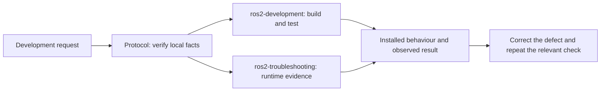

<div align="center">


**情境化封装 ROS 2 验证工具、工作流与交接证据。**


[English](README.md) | [한국어](README.ko.md) | **中文** | [日本語](README.ja.md) | [Español](README.es.md) | [Français](README.fr.md) | [Deutsch](README.de.md)

</div>

适用于 **Ubuntu 24.04 / ROS 2 Jazzy** 的三个 Claude Code 与 Codex 技能：开发软件包、核实测试与安装产物、诊断运行时故障。

本项目遵循 [Agent Skills 规范](https://agentskills.io/home)，将领域知识、开发工作流与可执行诊断工具打包。我们并不声称提高前沿大模型的固有代码生成能力，而是探索一个工程设计假设：**通过封装特定环境的证据检查和结构化交接记录，能否减少会话间验证歧义与上下文交接成本。** 虽然各工具的独立功能已在测试环境中通过验证，但**降低交接成本或提高整体开发生产率仍属未经证实的假设。**

## 快速上手

所有环境均默认支持自动技能发现（skill discovery）。在 Claude Code 中，请仅选择插件安装或手动安装中的一种。

**Codex — 安装到现有项目：**

```bash
git clone https://github.com/Leehyunbin0131/claude-ros2-skills.git
python3 claude-ros2-skills/scripts/install.py --agent codex --project /path/to/your-workspace
# 或安装至当前用户的所有项目：
# python3 claude-ros2-skills/scripts/install.py --agent codex --user
```

技能安装在 [Codex 官方技能目录](https://learn.chatgpt.com/docs/build-skills)（`<project>/.agents/skills` 或 `~/.agents/skills`），并在激活技能时加载共享[验证协议](CLAUDE.md)。保留现有的 `AGENTS.md`、`CLAUDE.md`、Codex 配置与其他技能；若存在本地修改则中止更新。受限沙盒中的运行时限制详见 [evals/CODEX.md](evals/CODEX.md)。

**Claude Code — 插件安装：**

```text
/plugin marketplace add Leehyunbin0131/claude-ros2-skills
/plugin install claude-ros2-skills@claude-ros2-skills
```

启动新会话后，`SessionStart` 钩子会传递共享[验证协议](CLAUDE.md)。

**Claude Code — 手动安装到现有项目：**

```bash
git clone https://github.com/Leehyunbin0131/claude-ros2-skills.git
python3 claude-ros2-skills/scripts/install.py --project /path/to/your-workspace
# 或安装至当前用户的所有项目：
# python3 claude-ros2-skills/scripts/install.py --user
```

安装脚本会复制 3 个技能及 `.claude/rules/ros2-verification.md`，并保留现有的 `CLAUDE.md` 与其他技能。在已安装 Jazzy 的 Ubuntu 环境中，可按如下方式准备检查工具依赖：

```bash
sudo apt install python3-colcon-common-extensions python3-pytest \
  ros-jazzy-tf2-ros ros-jazzy-sensor-msgs ros-jazzy-nav-msgs
source /opt/ros/jazzy/setup.bash
```

## 技能列表

| 技能 | 适用场景 | 提供内容 |
| :--- | :--- | :--- |
| [ros2-development](skills/ros2-development/SKILL.md) | 创建或修改软件包、节点、接口、launch、配置及测试 | 依赖感知构建、安装产物验证、检测空测试运行、用于任务交接的自选证据跟踪工具 |
| [ros2-troubleshooting](skills/ros2-troubleshooting/SKILL.md) | 运行时的发布者、回调、TF、IMU 或里程计异常 | 4 个可执行诊断脚本，以及坐标系（REP 103/105）、QoS、实机标定参考资料 |
| [ros2-microros](skills/ros2-microros/SKILL.md) | MCU 通信、Agent、rclc、消息内存 | 源码索引与故障诊断指南；**未经 MCU 实机验证** |

## 可执行验证与证据工具

脚本存放在各技能目录下。示例中的 `ROS2_SKILL_DIR` 是由智能体内部设置为已加载技能目录的示例变量，不需要用户手动输入。这些脚本是普通 Python 文件，不能通过 `ros2 run` 调用。

| 脚本 | 目的与检查的证据 |
| :--- | :--- |
| `ros2-development/scripts/check_test_results.py <results> --packages <name>` | 检查新 colcon 报告中实际执行并通过的测试；使用 `--require-test PACKAGE::test_name` 指定关键回归测试（避免仅靠代码风格检查通过） |
| `ros2-development/scripts/evidence.py begin / finish / inspect` | **可选（opt-in）工作流**：记录调用方声明的命令元数据并比对工作区文件哈希与选定环境变量值，支持任务交接 |
| `ros2-troubleshooting/scripts/check_qos_compat.py --topic /scan` | 发布者/订阅者端点间的原生 Jazzy QoS 兼容性 |
| `ros2-troubleshooting/scripts/check_tf_tree.py --sensors laser_frame,imu_link` | TF 树连通性与实机对比用的安装 RPY 欧拉角（特殊角度提示仅供参考） |
| `ros2-troubleshooting/scripts/check_imu_gravity.py --topic /imu/data` | 应用已声明 TF 或 `--assume-aligned` 后，检查水平基座坐标系（`--base base_link`）中的 +Z 重力测量值；至少需 2 个样本，样本间 RMS 偏差 >1.5 m/s²（可通过 `--max-variation` 调整）或缺失 TF 时返回无法判定；不能证明物理静止或验证 yaw |
| `ros2-troubleshooting/scripts/check_odom_direction.py --topic /odom` | 外部观察到的实际移动前后的新里程计方向（仅验证方向，不验证距离标定） |

- **诊断脚本退出代码**：`0` 通过（PASS），`1` 失败（FAIL），`2` 无法判定或请求无效（INCONCLUSIVE）。
- **证据检查（`inspect`）退出代码**：`0` 一致（Consistent），`1` 已变更（Changed），`2` 不完整（Incomplete）。

数据缺失、NaN、不可用的 IMU 字段、样本不足（<2）、样本偏差过大、未知 QoS、无执行测试或移动不足均不会视为成功。运行时检查不发布运动命令。证据工具严格区分调用方声明的结果与工具观察到的文件哈希，不会自动运行或重跑用户命令，也不保证整个机器人的健康状态。详见 [docs/DESIGN.md](docs/DESIGN.md) 与 [references/handoff.md](skills/ros2-development/references/handoff.md)。

## 工作流程



## 验证摘要与适用边界

- **CI 与测试夹具验证**：CI 自动检查安装保留、Python/Shell 语法、真实 Python/CMake 与 `ament` 测试包装器、合成 Jazzy 通信与 TF、证据快照契约（[docs/VALIDATION.md](docs/VALIDATION.md)）以及独立验收对照。
- **发布验收与对比研究**：在过往 Claude Code **Opus 5.5 High** 会话（[evals/development/RESULTS.md](evals/development/RESULTS.md)）中，技能与基线在相同任务上均通过。在冻结 `0.1.2` 快照的接口迁移实验中（[evals/workflow_value/RESULTS.md](evals/workflow_value/RESULTS.md)），技能组的输出 Token 与估计 API 成本更高，而观察到的耗时缩短受执行顺序、提示缓存与后台等待混淆影响——**本项目不声称任何 Token、总成本或速度优势。** 该 `0.1.2` 历史研究未评估 `0.2.0` 新增的交接工具。
- **未验证边界**：物理机器人、MCU 固件、实机标定以及完整的 Nav2/MoveIt/Gazebo 应用仍属未验证范围。

## 文档导航

| 文档 | 说明 |
| :--- | :--- |
| [CLAUDE.md](CLAUDE.md) | 会话加载的共享 ROS 2 Jazzy 验证协议 |
| [docs/DESIGN.md](docs/DESIGN.md) & [docs/VALIDATION.md](docs/VALIDATION.md) | `evidence.py` 交接工具的架构设计、契约边界与验证记录 |
| [evals/VALIDATION.md](evals/VALIDATION.md) & [evals/CODEX.md](evals/CODEX.md) | `0.1.2` 开发/诊断验证清单与 Codex 兼容性报告 |
| [evals/development/RESULTS.md](evals/development/RESULTS.md) & [evals/workflow_value/RESULTS.md](evals/workflow_value/RESULTS.md) | Claude Code 验收记录与接口变更对比研究 |
| [evals/CAPABILITIES.md](evals/CAPABILITIES.md)、[evals/AUTHORING.md](evals/AUTHORING.md)、[evals/LADDER.md](evals/LADDER.md) | 历史基线核对记录、技能编写标准与难度阶梯评估方法 |
| [CONTRIBUTING.md](CONTRIBUTING.md) | 贡献指南、证据级别要求与完整测试命令 |

## 更新与许可

插件更新：`claude plugin update claude-ros2-skills@claude-ros2-skills`。手动安装请拉取最新仓库后重新运行安装命令（若存在本地修改将拒绝覆盖以保护文件）。许可证：[Apache-2.0](LICENSE)。
